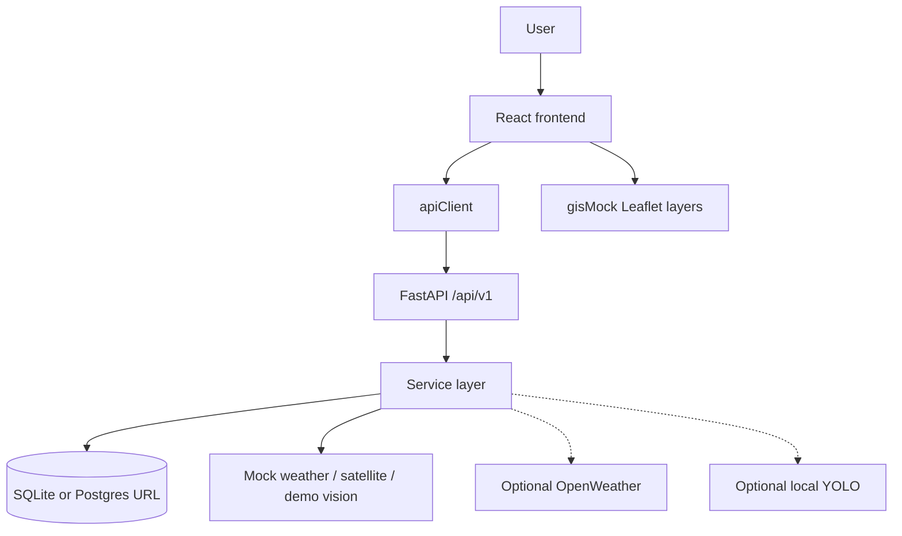

# VisionGuard AI

Intelligent **computer-vision disaster management** decision-support **prototype**. A React operations console and FastAPI `/api/v1` backend walk a **simulated** Kuttanad (Kerala) flood from weather and risk through satellite/flood/damage views, rescue recommendations, prototype alerts, and analytics.

**This is not an operational emergency system.** Default Demo Mode uses mock weather, synthetic satellite rasters, OpenCV/rule-based estimates, and dashboard alerts that are **not** government warnings. Live OpenWeather and local YOLO weights are optional. VisionGuard AI does not replace authorized emergency-management decisions.

Full documentation index: **[docs/README.md](docs/README.md)**

## Architecture



Source: [docs/diagrams/system-architecture.mmd](docs/diagrams/system-architecture.mmd)

## Main modules

| Module | UI route | Backend |
| --- | --- | --- |
| Dashboard | `/dashboard` | disasters, alerts, analytics |
| Weather | `/weather` | `/weather/*`, `/risk/*` |
| Risk | `/risk-intelligence` | `/risk-zones`, `/risk/flood` |
| Satellite | `/satellite` | `/satellite/*` |
| Flood | `/flood-detection` | `/flood/*` |
| Computer vision | `/computer-vision` | `/vision/*` |
| Damage | `/damage-assessment` | `/damage/*` |
| Rescue | `/rescue-planning` | `/rescue/*`, `/resources` |
| Alerts | `/alerts` | `/alerts/*` |
| Analytics | `/analytics` | `/analytics/*` |
| Incident | `/disasters/:id` | `/incidents/{id}` |

## Technology stack

| Layer | Actual stack |
| --- | --- |
| Frontend | React 19, TypeScript, Vite, Tailwind, Leaflet, Chart.js |
| Backend | FastAPI, SQLAlchemy, Pydantic, NumPy, OpenCV headless |
| Data | SQLite default; Compose can start PostGIS (ORM still uses JSON GeoJSON) |
| AI | Demo detectors + heuristics; optional Ultralytics YOLO if you supply weights |

**PyTorch is not in this repository.**

## Project structure

```
frontend/   React UI
backend/    FastAPI product API
ai/         Stub package (not imported by FastAPI)
src/        Legacy NASA/NOAA/OpenWeather API (not the dashboard backend)
docs/       Guides and Mermaid diagrams
scripts/    Demo seed
```

## How data flows

Pages call `frontend/src/services/*`. If `VITE_USE_MOCK` is not `"false"`, they use `data/mock.ts`. Otherwise they `fetch` `/api/v1`. FastAPI services read/write SQLAlchemy models and/or mock providers. The command map uses **static** `gisMock.ts`, not PostGIS. Details: [docs/diagrams/data-flow.mmd](docs/diagrams/data-flow.mmd).

## How to run

```powershell
copy .env.example .env
copy frontend\.env.example frontend\.env
cd backend
pip install -r requirements.txt
uvicorn app.main:app --reload --app-dir .
```

```powershell
cd frontend
npm install
npm run dev
```

- UI: http://127.0.0.1:5173/dashboard  
- API: http://127.0.0.1:8000/docs  

Seed: `python scripts/seed_demo_data.py`  
Docker: `docker compose up --build` (needs Docker engine)  
More: [docs/RUNNING_THE_PROJECT.md](docs/RUNNING_THE_PROJECT.md)

## Demo workflow

Kuttanad flood ID `aaaaaaaa-aaaa-4aaa-8aaa-aaaaaaaaaaaa`: Dashboard → Incident → Weather → Risk (82% simulated) → Satellite → Flood → Damage → Rescue (accept/modify/reject) → Alerts → Analytics.  
Walkthrough: [docs/END_TO_END_EXAMPLE.md](docs/END_TO_END_EXAMPLE.md)

## AI capabilities (actual)

| Capability | What it is |
| --- | --- |
| Flood extent | OpenCV water pixels — **not** trained U-Net |
| Damage | Raster change + rules — **not** a trained damage net |
| Vision | `DemoVisionModel` boxes; YOLO only with local file |
| Risk | Weighted formulas + optional 82% demo overlay |
| Rescue | If-then resources + demo graph routes |

## Current implementation status

See the matrix: [docs/IMPLEMENTATION_STATUS.md](docs/IMPLEMENTATION_STATUS.md).

## Documentation

**[docs/README.md](docs/README.md)** — architecture, API reference, GIS, AI honesty labels, diagrams, technical debt.

## Screenshots

_Add demo captures here before presentation._
