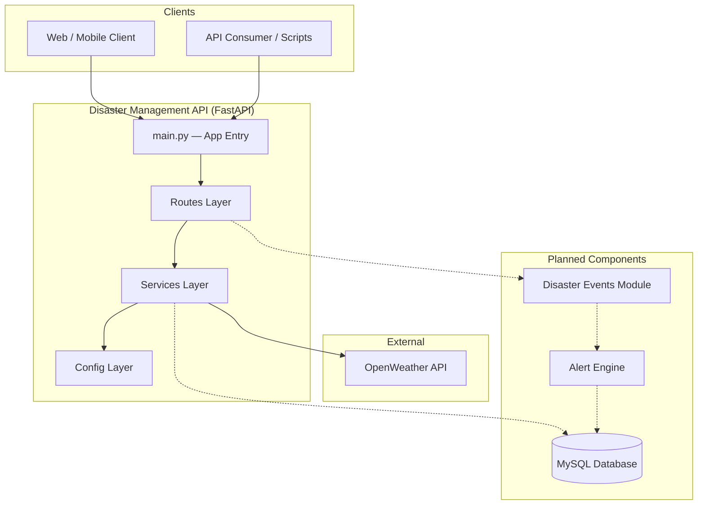
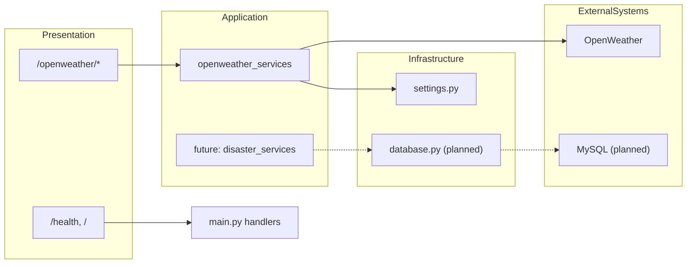
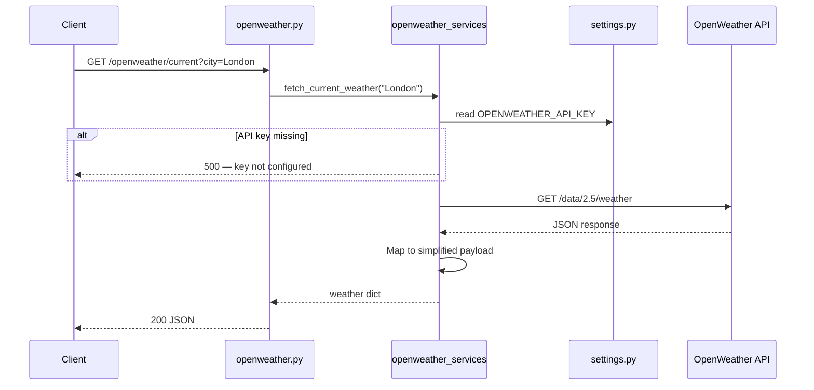
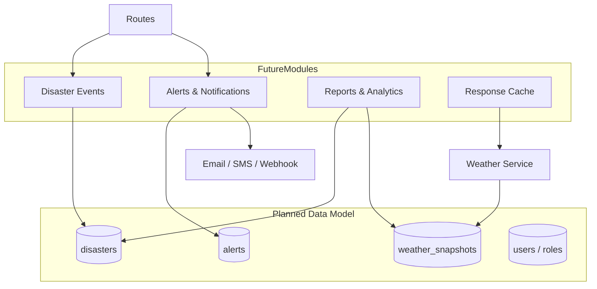
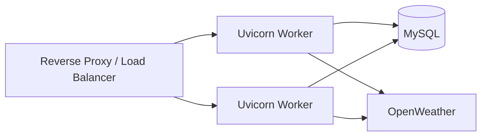

# Disaster Management System — Architecture Design

## 1. Overview

The Disaster Management System is a Python web API built with **FastAPI**. It aggregates environmental and weather data from external providers to support disaster preparedness, monitoring, and response workflows.

**Current scope:** OpenWeather integration for current weather, forecasts, and air quality.

**Planned scope:** Persistent storage (MySQL), disaster event tracking, alerts, and reporting.

---

## 2. Design Principles

| Principle | Description |
|-----------|-------------|
| **Layered separation** | Routes handle HTTP; services contain business logic; config holds environment settings. |
| **Thin controllers** | Route handlers delegate to services and do not call external APIs directly. |
| **Configuration externalized** | Secrets and connection strings live in `.env`, loaded via `settings.py`. |
| **Fail fast** | Missing API keys and upstream errors surface as clear HTTP exceptions. |
| **Extensibility** | New data providers and disaster modules are added as routers + services without changing the app entry point. |

---

## 3. High-Level Architecture



---

## 4. Layered Architecture



### 4.1 Presentation Layer (`src/main.py`, `src/app/routes/`)

- **Responsibility:** HTTP routing, request/response contracts, OpenAPI documentation.
- **Components:**
  - `main.py` — FastAPI app instance, root and health endpoints, router registration.
  - `openweather.py` — `/openweather/current`, `/openweather/forecast`, `/openweather/air-quality`.

### 4.2 Application / Service Layer (`src/app/services/`)

- **Responsibility:** Business logic, external API orchestration, data transformation.
- **Components:**
  - `openweather_services.py` — Fetches and normalizes weather, forecast, and air-quality data.

### 4.3 Configuration Layer (`src/app/config/`)

- **Responsibility:** Environment variables, database connection setup (planned).
- **Components:**
  - `settings.py` — Loads `.env`; exposes `OPENWEATHER_API_KEY` and MySQL settings.
  - `database.py` — *(planned)* SQLAlchemy engine and session factory.

### 4.4 Data Layer *(planned)*

- **Responsibility:** Persistence for disasters, alerts, historical weather snapshots, and audit logs.
- **Technology:** MySQL via SQLAlchemy + PyMySQL (dependencies already in `requirements.txt`).

---

## 5. Request Flow (Current)

Example: `GET /openweather/current?city=London`



### Air quality flow (two-step geocoding)

1. Resolve city name → coordinates via OpenWeather Geocoding API.
2. Fetch air pollution data for `lat` / `lon`.

---

## 6. Project Structure

```
Disaster_Management_System/
├── docs/
│   └── ARCHITECTURE.md          # This document
├── src/
│   ├── main.py                  # FastAPI application entry point
│   └── app/
│       ├── config/
│       │   ├── settings.py      # Environment configuration
│       │   └── database.py      # Database setup (planned)
│       ├── routes/
│       │   └── openweather.py   # OpenWeather HTTP endpoints
│       └── services/
│           └── openweather_services.py  # OpenWeather integration logic
├── .env.example                 # Environment variable template
├── requirements.txt             # Python dependencies
└── README.md                    # Setup and usage guide
```

---

## 7. Technology Stack

| Layer | Technology |
|-------|------------|
| Web framework | FastAPI 0.139 |
| ASGI server | Uvicorn |
| HTTP client | Requests |
| Validation / schemas | Pydantic (via FastAPI) |
| Configuration | python-dotenv |
| Database *(planned)* | MySQL, SQLAlchemy 2.x, PyMySQL |

---

## 8. API Surface (Current)

| Method | Path | Service Function | External API |
|--------|------|------------------|--------------|
| GET | `/` | `root()` | — |
| GET | `/health` | `health()` | — |
| GET | `/openweather/current` | `fetch_current_weather` | Weather 2.5 |
| GET | `/openweather/forecast` | `fetch_weather_forecast` | Forecast 2.5 |
| GET | `/openweather/air-quality` | `fetch_air_quality` | Geocoding + Air Pollution |

Interactive docs: `http://127.0.0.1:8000/docs`

---

## 9. Configuration

| Variable | Required | Purpose |
|----------|----------|---------|
| `OPENWEATHER_API_KEY` | Yes | Authenticates OpenWeather requests |
| `MYSQL_HOST` | No *(planned)* | Database host |
| `MYSQL_PORT` | No *(planned)* | Database port |
| `MYSQL_USER` | No *(planned)* | Database user |
| `MYSQL_PASSWORD` | No *(planned)* | Database password |
| `MYSQL_DATABASE` | No *(planned)* | Database name |

---

## 10. Error Handling

| Condition | HTTP Status | Source |
|-----------|-------------|--------|
| Missing `OPENWEATHER_API_KEY` | 500 | `_require_api_key()` |
| City not found (geocoding) | 404 | `fetch_coordinates()` |
| OpenWeather API error | Same as upstream | `_get_json()` |
| Request timeout | 10s limit on `requests.get` | `openweather_services` |

---

## 11. Planned Architecture Extensions



### 11.1 Disaster Events Module *(planned)*

- CRUD for disaster incidents (type, severity, location, status).
- Link incidents to weather snapshots at time of report.

### 11.2 Alerts Module *(planned)*

- Rule-based triggers (e.g., high wind, poor air quality, flood risk).
- Notification channels and escalation policies.

### 11.3 Database Integration *(planned)*

- Implement `database.py` with SQLAlchemy engine and dependency-injected sessions.
- Add `models/` and `repositories/` packages following existing layer conventions.

### 11.4 Suggested Future Directory Layout

```
src/app/
├── config/
├── models/           # SQLAlchemy ORM models
├── repositories/     # Data access
├── routes/
│   ├── openweather.py
│   ├── disasters.py
│   └── alerts.py
├── schemas/          # Pydantic request/response models
└── services/
```

---

## 12. Security Considerations

- **Secrets:** Never commit `.env`; use `.env.example` as a template only.
- **API keys:** OpenWeather key is server-side only; not exposed to clients.
- **Input validation:** City names are passed as query parameters; add length/sanitization rules as the API grows.
- **Database *(planned)*:** Use parameterized queries via SQLAlchemy; restrict DB user privileges.
- **Authentication *(planned)*:** Add JWT or API-key auth before exposing write operations on disaster data.

---

## 13. Deployment Topology *(reference)*



For local development, a single Uvicorn process on `127.0.0.1:8000` is sufficient.

---

## 14. Version History

| Version | Date | Changes |
|---------|------|---------|
| 1.0 | 2026-07-14 | Initial architecture — OpenWeather integration, layered FastAPI structure |
