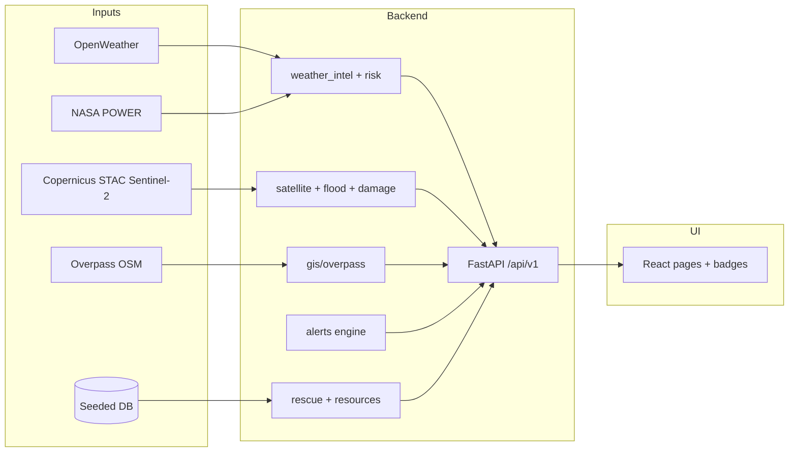

# VisionGuard — Judge / Demo Presentation Script

Use this for “fully completed project” demos. Match what the UI badges say (`LIVE` / `DERIVED` / `SEEDED` / `MOCK`). Prefer **LIVE DATA MODE** (`USE_MOCK_PROVIDERS=false`, `VITE_USE_MOCK=false`).

---

## 30-second opening

> “VisionGuard is a **disaster operations decision-support console** for a Kerala flood scenario (Kuttanad / Alappuzha).  
> React UI → FastAPI services → external data providers.  
> We fuse **live weather**, **live Sentinel-2 catalogue previews**, **OSM reference GIS**, and **seeded ops data**, then run **transparent heuristics** for flood change and damage indication.  
> Badges show LIVE vs DERIVED vs SEEDED — we do **not** claim official IMD warnings or a trained flood U-Net.”

Point at header: **LIVE DATA MODE** + provenance panel.

---

## End-to-end workflow (say while clicking)

**Storyline (8–12 min click path)**

| # | Page | What you demonstrate | How result is generated |
| --- | --- | --- | --- |
| 1 | Dashboard | One incident, KPIs, map | Seeded disaster + analytics; map layers may mix live GIS + demo catalog |
| 2 | Weather | Current / forecast / history | OpenWeather + NASA POWER HTTP → risk rules |
| 3 | Satellite | Scene list + previews | Copernicus STAC search + thumbnail fetch |
| 4 | Flood Detection → **Run** | Change area / water indication | Before/after RGB previews → OpenCV water mask **change** (`after & ~before`) |
| 5 | Damage → **Run** | Severity classes | Same EO change signals → rule classifier (not trained damage net) |
| 6 | Rescue → plan → **Accept** | Priorities + human gate | Seeded resources + scoring; officer must accept |
| 7 | Alerts → generate / ack | Early-warning list | Thresholds from weather/risk (`rules.json`) |
| 8 | Settings / provenance | Honesty | `GET /data-sources/status` |

---

## Datasets available vs what we chose

| Dataset / source | Available for this task? | Used? | Justification (say this) |
| --- | --- | --- | --- |
| **OpenWeather** current/forecast | Yes (API key) | **Yes — LIVE** | Fast, city-query weather for Alappuzha; good for prototype risk inputs without owning gauges |
| **NASA POWER** daily history | Yes (public) | **Yes — LIVE** | Free reanalysis/meteo history at lat/lon; complements OpenWeather for rainfall trends |
| **IMD official warnings** | Yes if key | **Not configured** | Would be authoritative; we leave it off rather than fake official alerts |
| **Copernicus Sentinel-2** (STAC + RGB previews) | Yes (public catalogue) | **Yes — LIVE** | Free EO over India; before/after scenes for visual change; no paid commercial imagery needed |
| **Sentinel-1 SAR** | Possible | **Not used** | Better for cloudy flood mapping, but heavier processing; RGB optical previews fit demo latency |
| **Google Earth Engine** | Possible | **Not used** | Powerful but heavier auth/ops; STAC+thumbnails keep the stack self-hosted and explainable |
| **OpenStreetMap / Overpass** | Yes | **Yes — STATIC_EXTERNAL** | Roads/amenities for situation awareness; not live flood telemetry |
| **Seeded SQLite incidents/resources** | Yes | **Yes — SEEDED** | Ops inventory (boats, centers) isn’t available as a public live API for this demo |
| **River / telemetric gauges** | Ideal | **UNAVAILABLE** | Not wired — we show UNAVAILABLE instead of inventing levels |
| **Frontend `gisMock` catalog polygons** | Demo GeoJSON | **Labeled MOCK** | Command-map story layers for the Kuttanad narrative |

---

## Models / algorithms available vs what we chose

| Approach | Available? | Used? | Justification |
| --- | --- | --- | --- |
| **OpenCV / NumPy RGB water + change** | Yes | **Yes (flood)** | Deterministic, CPU-only, explainable in a viva; works on STAC preview JPEGs |
| **U-Net / DeepLab flood segmentation** | Interfaces stubbed | **No weights shipped** | Would need labeled Kerala flood training; claiming it without weights would be dishonest |
| **Heuristic damage classifier** (thresholds on change features) | Yes | **Yes (damage)** | Same EO inputs → severity labels for ops UI; transparent rules |
| **Trained damage CNN** | Not shipped | **No** | Needs curated building damage labels; out of scope for this prototype |
| **Rule-based flood/cyclone risk %** | Yes | **Yes** | Maps weather features → scores officers can challenge; **not** IMD |
| **Alert rules JSON** | Yes | **Yes** | Configurable INFO→CRITICAL without ML |
| **DemoVisionModel** | Yes (default) | Demo path | Simulated detections when no weights |
| **YOLO (Ultralytics)** | Optional local `.pt` | **NOT_CONFIGURED** unless weights file set | Generic COCO YOLO ≠ disaster classes; we don’t auto-download hubs |
| **Rescue priority scoring** | Yes | **Yes** | Multi-factor ranking + **human Accept** (safety) |

**One-line model honesty:**  
> “Results labeled DERIVED_LIVE are **computed from live inputs** with heuristics/rules — not a production AI flood product.”

---

## “Where does processing happen?” cheat sheet

| Question | Open this file | Function / note |
| --- | --- | --- |
| API entry (all routes) | `backend/app/api/v1/router.py` | e.g. `POST /flood/analyze`, `/damage/analyze`, `/weather/current` |
| App startup / mode | `backend/app/main.py`, `backend/app/core/config.py` | `USE_MOCK_PROVIDERS` |
| Provider switch | `backend/app/services/weather/factory.py`, `satellite/service.py` | Live vs mock providers |
| Weather + risk | `backend/app/services/weather_intel.py`, `services/risk/*.py` | Live HTTP → risk scores |
| Satellite catalogue | `backend/app/services/satellite/copernicus_provider.py` | STAC search |
| **Flood water change** | `backend/app/services/satellite/processing.py` → `compare_water_change` | `after & ~before` |
| Flood orchestration | `backend/app/services/flood/service.py` → `analyze` | Picks before/after scenes, builds FloodAnalysis |
| Damage classify | `backend/app/services/damage/service.py`, `damage/classify.py` | Severity labels |
| Alerts | `backend/app/services/alerts/engine.py` + `rules.json` | Threshold engine |
| GIS Overpass | `backend/app/services/gis/overpass.py` | OSM features |
| Provenance badges | `backend/app/services/provenance.py` | `/data-sources/status` |
| Seeded DB | `backend/app/db/seed.py` | Incidents, resources |
| UI mode + badges | `frontend/src/layouts/AppLayout.tsx`, `components/DataModeBadge.tsx` | LIVE vs DEMO |
| Flood page call | `frontend/src/pages/...` + `services/*` → `apiClient.ts` | Hits `/api/v1/flood/analyze` |

**Trace one request aloud:**  
UI button → `apiClient` → `router.py` endpoint → `FloodService.analyze` → Copernicus scenes → `compare_water_change` → JSON + provenance → UI map/KPI.

---

## Likely viva Q&A

**Q: Is this live satellite AI?**  
A: Live **catalogue + preview imagery**; analysis is **heuristic change**, labeled DERIVED_LIVE — not a trained segmentation model.

**Q: Why not U-Net?**  
A: No validated local weights or labeled Kerala flood set in-repo; heuristic on real previews is reproducible and honest for a demo.

**Q: Why OpenWeather not IMD?**  
A: OpenWeather is wired and working for Alappuzha; IMD needs a key and is the official channel — we expose the plug-in but don’t fake warnings.

**Q: Are rescue resources real?**  
A: **SEEDED** demo inventory so the planning workflow is complete; Accept is mandatory.

**Q: Demo vs Live?**  
A: Env flags; Live refuses silent mock fallbacks and surfaces UNAVAILABLE / NOT_CONFIGURED.

---

## Pre-demo checklist

1. Backend + frontend running; header shows **LIVE DATA MODE**.  
2. `GET /api/v1/health` → `data_mode: REAL DATA`.  
3. Flood page: run analysis once so before/after scene IDs appear.  
4. Know AOI: **Alappuzha / Kuttanad** (~9.517, 76.522).  
5. If asked code: open `flood/service.py` + `processing.compare_water_change`.

Full module table: `docs/DATA-PROVENANCE-STATUS.md`. Architecture: `docs/LIVE-DATA-ARCHITECTURE.md`.
